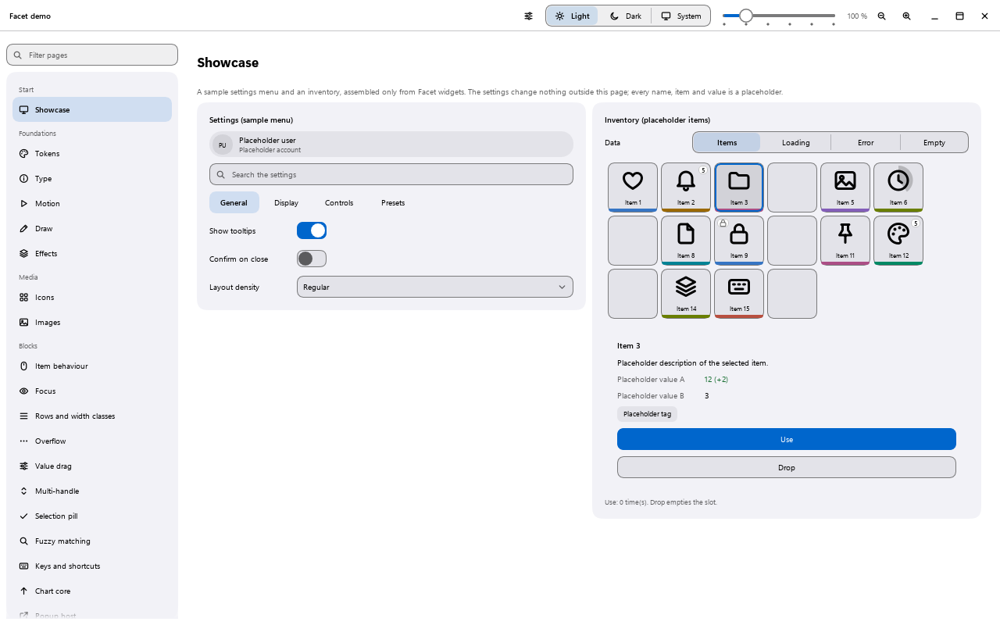
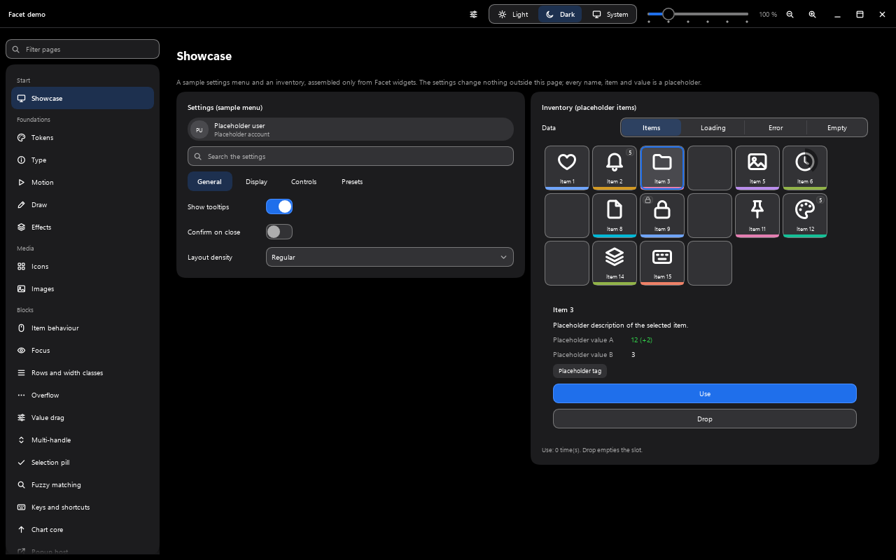
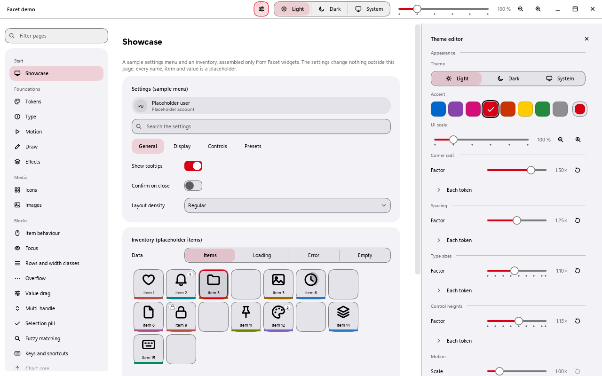
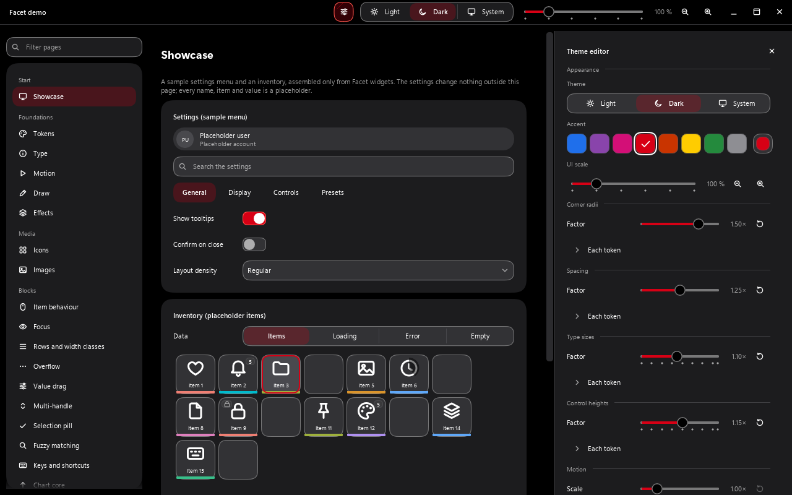
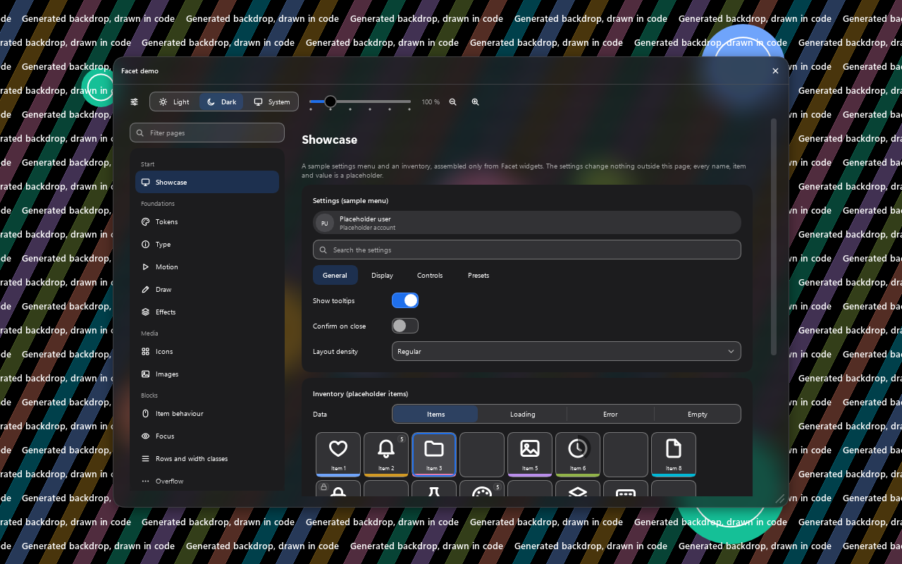
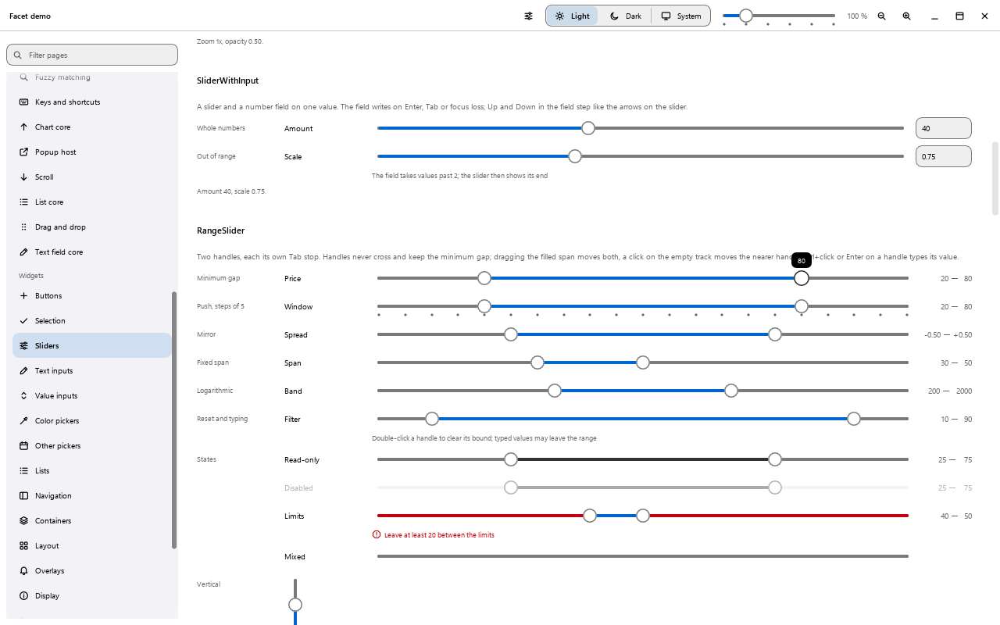
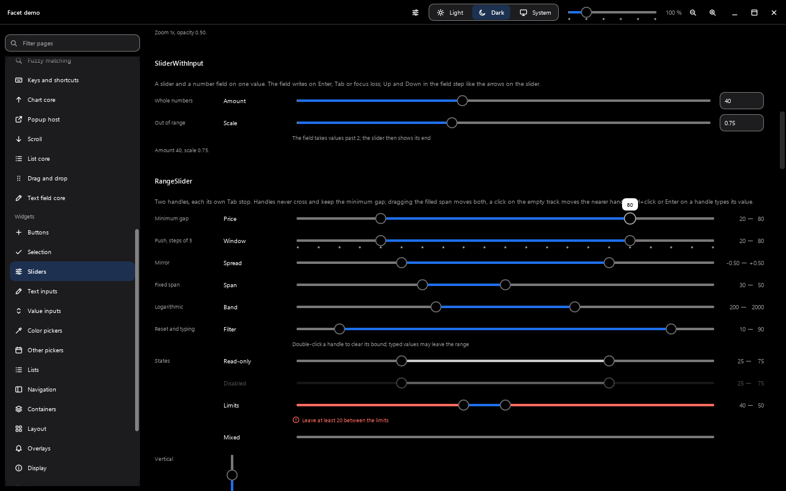
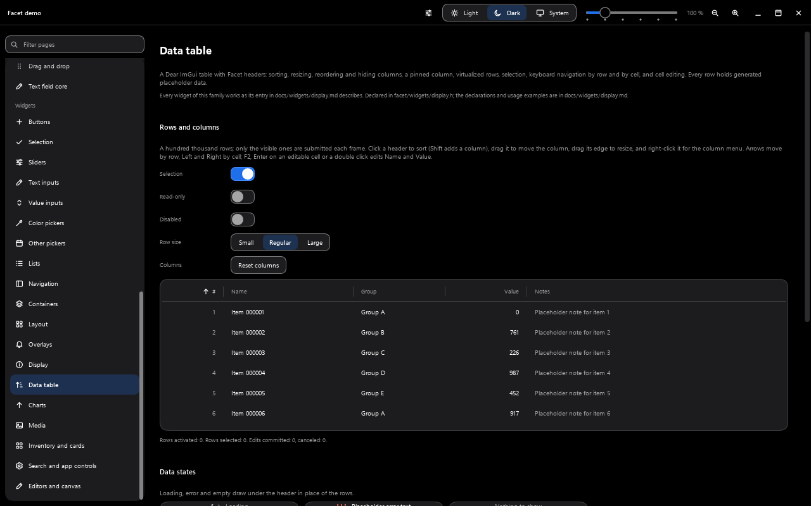

# Facet

Facet is a design framework for Dear ImGui applications on Windows with Direct3D 11. It adds a
set of custom widgets, a light and a dark theme built from design tokens with an accent color set
at run time, SVG icons and images, and scaling for desktop windows and overlay menus. Dear ImGui
stays unmodified, and Facet widgets mix with stock Dear ImGui calls in the same window.

## Screenshots

Taken from the test app with its capture mode at 1280x800 and UI scale 1. Every name, item and
value in them is a placeholder of the test app.

The showcase page, a sample settings menu next to an inventory grid, in the light and the dark
theme:




The theme editor open beside the showcase page, with a custom red accent and larger corner radii,
spacing, type sizes and control heights:




Overlay mode: the gallery as a floating shell with backdrop blur over a generated backdrop:



The sliders page with the two-handle range sliders while a handle is dragged, and the data table:





## Requirements

- Windows 10 or 11.
- Visual Studio 2026 (or its Build Tools) with the C++ workload (MSVC v145) and a Windows SDK.
  The library and its public headers need C++20.
- CMake 4.2 or newer for the "Visual Studio 18 2026" generator of the presets. The project
  itself requires CMake 3.28.
- Git and network access on the first configure: CMake downloads Dear ImGui, FreeType, lunasvg
  and doctest. Fonts are not downloaded: Facet loads Segoe UI from Windows at run time.

## Using Facet in a project

Facet is added from source with `add_subdirectory` and linked as `facet::facet`. Dear ImGui comes
from one of two places:

- **Facet fetches it** (the default): Dear ImGui v1.93.0, with FreeType for font rasterization.
  The Win32 and DX11 backends are a separate target, `facet::imgui_backends`.
- **The project brings its own**: set `FACET_IMGUI_TARGET` to the project's Dear ImGui target
  before `add_subdirectory`. Facet compiles against that target and its `imconfig.h` and fetches
  neither Dear ImGui nor FreeType.

The application calls `facet::Init` with its Direct3D 11 device and context before the first
frame, `facet::NewFrame` after `ImGui::NewFrame`, `facet::EndFrame` before `ImGui::Render`, and
`facet::Shutdown` before the backends shut down. [Getting started](docs/getting-started.md) walks
through both paths, the call order, device loss, the scale modes, icons and images, with code
from `examples/consumer`, a small application that builds against its own Dear ImGui target.

## A minimal example

Shortened from `DrawContent` in `examples/consumer/main.cpp`, which runs between
`facet::NewFrame` and `facet::EndFrame`:

```cpp
if (!facet::BeginAppFrame("consumer"))
    return;

facet::Text(facet::TextStyle::Title2, "Facet consumer example");

if (facet::Toggle("Dark theme", &state.dark))
    facet::SetThemeMode(state.dark ? facet::ThemeMode::Dark : facet::ThemeMode::Light);

if (facet::Slider("UI scale", &state.uiScale, 0.75f, 2.0f, {.format = "%.2f", .step = 0.25, .width = 320.0f}))
    facet::SetUiScale(state.uiScale);

if (facet::Button("Count a press", {.variant = facet::ButtonVariant::Primary}))
{
    ++state.presses;
    facet::ShowToast("Button pressed", {.tone = facet::Tone::Success});
}

facet::EndAppFrame();
```

Widgets follow Dear ImGui's label and id rules, take their optional settings as one options
struct with designated initializers, and measure lengths in design units that Facet scales. The
rules every widget declaration follows are in [the API conventions](docs/api-conventions.md).

## Widgets

The widgets are grouped into fourteen families, one header each under `include/facet/widgets/`;
`facet/facet.h` includes everything. Every widget declared in these headers is implemented; each
entry on its family page ends with its status. Additions that are planned and not declared yet
are listed at the end of the family pages that have them.

| Family | Status | What it holds |
|---|---|---|
| [Buttons](docs/widgets/buttons.md) | Ready | Push buttons with variants, icon buttons, copy buttons, links, toggle button groups |
| [Selection](docs/widgets/selection.md) | Ready | Toggles, checkboxes, radio groups, segmented controls, chips, cycle selectors, option cards |
| [Lists](docs/widgets/lists.md) | Ready | Dropdowns, combo boxes, list boxes, selectable and reorderable lists, tree views, transfer lists |
| [Sliders](docs/widgets/sliders.md) | Ready | Sliders, range sliders, multi-handle sliders, knobs, two-dimensional pads |
| [Inputs](docs/widgets/inputs.md) | Ready | Text, search and number fields, drag and vector fields, special-purpose fields, key bind capture |
| [Pickers](docs/widgets/pickers.md) | Ready | Color, date, time, angle, icon and thumbnail pickers, the file browser |
| [Navigation](docs/widgets/navigation.md) | Ready | Sidebar, tab bars, menu bars and menus, breadcrumbs, pagination, wizards |
| [Containers](docs/widgets/containers.md) | Ready | The floating shell, the app frame, tool and status bars, accordions, cards, scroll areas, virtual lists |
| [Layout](docs/widgets/layout.md) | Ready | Stacks, grids, flow, split views, panels, settings rows, separators, item grids |
| [Overlays](docs/widgets/overlays.md) | Ready | Modals, popovers, context menus, tooltips, toasts, drawers, the command palette |
| [Display](docs/widgets/display.md) | Ready | Text styles, alerts, empty states, progress, badges, key caps, code and log views, data tables |
| [Charts](docs/widgets/charts.md) | Ready | Sparklines, line, bar and donut charts, gauges, meters, legends |
| [Media](docs/widgets/media.md) | Ready | Images in design units, avatars, thumbnail strips, carousels, image viewers, drop zones |
| [Composites](docs/widgets/composites.md) | Ready | Inventory grids, presets, settings search, key bind lists, property grids, curve and gradient editors |

[docs/widgets.md](docs/widgets.md) has the overview with the headers.

Known limitation: two places still show Dear ImGui's own scrollbar instead of Facet's overlay
scrollbar: a popup level whose content is taller than the room (the menu, popover or dialog
window itself; lists inside a level scroll with the overlay bar), and the multiline text of
`TextArea`, which sizes and colors the stock bar from the scroll tokens. The overlay bar for both
is planned.

## The test app

`facet_demo` shows every part of the library on a page of its own, in both themes and at UI
scales from 75 to 200 %. It opens on the showcase page, a sample settings menu and an inventory
grid built only from Facet widgets. The navigation groups the other pages: Foundations (tokens,
type, motion, drawing, effects), Media (icons, images), Blocks (one page per shared building
block) and Widgets (one or more pages per widget family). The title bar holds the theme editor
and, as far as the width allows, the theme mode and the UI scale. The editor changes radii,
spacing, type sizes, control heights, motion, blur, shadows and the accent of the live theme and
copies the edits as C++ code. `--overlay`, or a switch in the editor, floats the gallery as a
shell over a generated backdrop; F9 shows and hides it.

Besides its window it has a capture mode, which renders pages offscreen into PNG files, and a
selftest mode, which operates the pages with scripted mouse and keyboard input and checks the
results. Both run on the WARP software rasterizer with `--warp`.

```
build\msvc-x64\bin\Release\facet_demo.exe [--page id] [--theme light|dark] [--overlay] [--warp]
build\msvc-x64\bin\Release\facet_demo.exe --list-pages
build\msvc-x64\bin\Release\facet_demo.exe --capture out --theme both --warp
build\msvc-x64\bin\Release\facet_demo.exe --capture out --matrix --page showcase --warp
build\msvc-x64\bin\Release\facet_demo.exe --selftest --theme both --warp
```

`--list-pages` prints the page ids with their capture states. `--matrix` captures one page at
900x600, 1280x800 and 1920x1200, at scales 1, 1.5 and 2, in app and overlay mode.
[docs/demo.md](docs/demo.md) describes the window, the pages and every run option.

## Building and testing

```
cmake --preset msvc-x64
cmake --build --preset msvc-x64-release
ctest --preset msvc-x64-release
```

Other build presets: `msvc-x64-debug`, `msvc-x86-release`, `msvc-x86-debug` (configure preset
`msvc-x86`). Build output goes to `build/<preset>/`, programs to
`build/<preset>/bin/<Debug|Release>/`. The configure preset `msvc-ninja-x64` (build and test
presets `msvc-ninja-x64-debug` and `msvc-ninja-x64-release`) uses Ninja Multi-Config with `cl`
and has to be run from an x64 developer command prompt.

CTest runs `facet_tests`, the doctest unit tests, and with `FACET_BUILD_CONSUMER_TEST` also
`facet_consumer`. Tests that need a device create a WARP device, so no GPU is needed. The
workflow in `.github/workflows/build.yml` runs the same configure, build and test on pushes and
pull requests to `main`, with the consumer test and warnings as errors on.

CMake options:

| Option | Default | Meaning |
|---|---|---|
| `FACET_BUILD_DEMO` | ON when top level | Build `facet_demo` |
| `FACET_BUILD_TESTS` | ON when top level | Build `facet_tests` and register them with CTest |
| `FACET_USE_FREETYPE` | ON | Rasterize fonts with FreeType (fetched Dear ImGui only) |
| `FACET_IMGUI_TARGET` | empty | Name of an existing Dear ImGui target to link instead of fetching Dear ImGui |
| `FACET_WARNINGS_AS_ERRORS` | OFF | Compile Facet's own code with `/WX` |
| `FACET_BUILD_CONSUMER_TEST` | OFF | Build `examples/consumer` as a nested project with its own Dear ImGui target and run it as the test `facet_consumer` |

The demo needs `facet::imgui_backends`, so it builds only when Facet fetches Dear ImGui.

### Repository layout

```
include/facet/     public headers: core/ (one per module), widgets/ (one per widget family)
src/               library sources; src/internal holds headers shared inside the library
assets/icons/      SVG files embedded into the library
cmake/             dependency, warning, asset embedding and consumer test scripts
docs/              guides; docs/widgets/ has one page per widget family, docs/images the
                   screenshots above
demo/              facet_demo; demo/pages holds one file per page
tests/             doctest unit tests; tests/support holds the shared Dear ImGui and WARP
                   session, tests/headers compiles every public header alone
examples/consumer/ a small application that uses Facet with its own Dear ImGui target
third_party/stb/   vendored stb headers
```

Source files are collected with globs, so a new file under `src/`, `demo/`, `tests/` or
`assets/icons/` is picked up without editing a CMake file. Demo pages and their selftest scripts
register themselves (`FACET_DEMO_PAGE`, `FACET_DEMO_SELFTEST` in `demo/pages/pages.h` and
`demo/selftest.h`). How a widget is built, tested, shown and documented is in
[writing a widget](docs/writing-a-widget.md).

## Design and theming

- [DESIGN.md](DESIGN.md): the starting value of every theme token and the reason for each visual
  choice; the reasons for the test app's own chrome are in [docs/demo.md](docs/demo.md).
- [Theming](docs/theming.md): the theme value and its presets, animated switches, light and
  dark mode, the accent, the contrast guarantees, stock Dear ImGui widgets and motion settings.
- [Scaling](docs/scaling.md): design units, the scale modes, text scale and pixel snapping.
- [Images and icons](docs/images-and-icons.md), [layout](docs/layout.md) (width classes and
  labelled rows) and [input](docs/input.md) (key chords, key binds and shortcuts).

## License

MIT, see [LICENSE](LICENSE). The third-party software Facet uses, what a program built with it
ships and the notices it needs are in [THIRD_PARTY_NOTICES.md](THIRD_PARTY_NOTICES.md).
